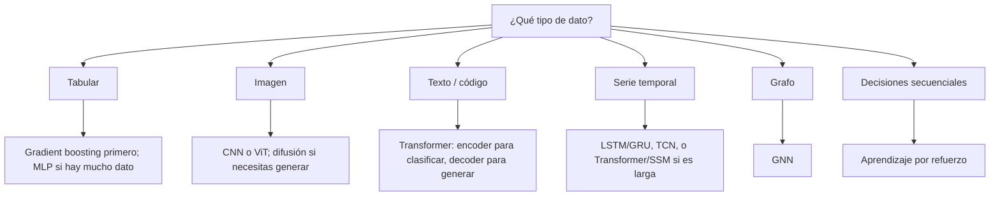

# Arquitecturas de IA: guía técnica

Guía en español de las principales arquitecturas de redes neuronales y de sistemas de IA: **qué son, para qué sirven, cómo funcionan por dentro y cuándo usarlas**. Cada arquitectura tiene un documento con diagramas, matemáticas esenciales, pros/contras y un ejemplo mínimo en PyTorch.

> Enfoque: técnico y práctico, escrito desde la perspectiva de quien tiene que *elegir, implementar y desplegar* estos modelos, no solo describirlos.

## Mapa rápido

| # | Arquitectura | Idea central | Sirve para | Ejemplos reales |
|---|---|---|---|---|
| 01 | [MLP / Perceptrón](docs/01-mlp.md) | Capas densas + no linealidad | Datos tabulares, cabezas de clasificación | Scoring de crédito, FFN dentro de Transformers |
| 02 | [CNN](docs/02-cnn.md) | Convoluciones: pesos compartidos y localidad | Imagen, audio, señales | ResNet, YOLO, U-Net |
| 03 | [RNN / LSTM / GRU](docs/03-rnn-lstm-gru.md) | Estado oculto recurrente | Series temporales, secuencias cortas | Predicción de demanda, ASR clásico |
| 04 | [Seq2Seq + Atención](docs/04-seq2seq-atencion.md) | Encoder-decoder con alineamiento suave | Traducción, resumen (pre-Transformer) | GNMT |
| 05 | [Transformer](docs/05-transformer.md) | Self-attention, paralelo, escala | Casi todo: texto, visión, audio, código | GPT, BERT, T5, ViT |
| 06 | [Variantes de LLM](docs/06-variantes-llm.md) | Encoder-only / decoder-only / enc-dec | Clasificación, generación, traducción | BERT, GPT, T5 |
| 07 | [Autoencoders / VAE](docs/07-autoencoders-vae.md) | Comprimir y reconstruir un espacio latente | Compresión, anomalías, generación | VAE, VQ-VAE |
| 08 | [GAN](docs/08-gan.md) | Generador vs. discriminador | Generación de imagen, super-resolución | StyleGAN |
| 09 | [Modelos de difusión](docs/09-difusion.md) | Aprender a quitar ruido iterativamente | Generación de imagen/video/audio | Stable Diffusion, DALL·E 3 |
| 10 | [GNN](docs/10-gnn.md) | Paso de mensajes en grafos | Moléculas, redes sociales, recomendación | GraphSAGE, GAT |
| 11 | [Mixture of Experts](docs/11-moe.md) | Activación dispersa de subredes | Escalar parámetros sin escalar cómputo | Mixtral, DeepSeek-MoE |
| 12 | [State Space Models](docs/12-ssm-mamba.md) | Recurrencia lineal con selección | Secuencias muy largas | Mamba, S4 |
| 13 | [Aprendizaje por refuerzo](docs/13-rl.md) | Agente + entorno + recompensa | Control, juegos, alineación (RLHF) | DQN, PPO, AlphaGo |
| 14 | [Multimodal](docs/14-multimodal.md) | Alinear espacios de embeddings distintos | Imagen+texto, búsqueda, VLMs | CLIP, LLaVA |
| 15 | [RAG y Agentes](docs/15-rag-agentes.md) | Modelo + recuperación + herramientas (sistema, no red) | Asistentes con datos propios, automatización | Chatbots empresariales, agentes de código |

## ¿Cuál elijo? (guía de decisión)



Regla práctica: **empieza con la baseline más simple** (regresión logística, XGBoost, un modelo preentrenado) y solo sube de complejidad si las métricas lo justifican.

## Estructura del repositorio

```
.
├── README.md
├── docs/            # un documento por arquitectura
├── examples/        # implementaciones mínimas en PyTorch (ejecutables)
├── requirements.txt
└── LICENSE
```

## Ejecutar los ejemplos

```bash
python -m venv .venv && source .venv/bin/activate
pip install -r requirements.txt
python examples/mlp.py
python examples/transformer_block.py
```

Cada script usa datos sintéticos, corre en CPU en segundos y termina con un `assert` o impresión que confirma que la forma de los tensores y la pérdida son razonables.

## Cómo leer cada documento

Todos siguen la misma plantilla: **Qué es → Para qué sirve → Cómo funciona → Variantes → Pros y contras → Cuándo usarla → Referencias.**

## Contribuir

PRs bienvenidos: correcciones, nuevas arquitecturas (flows, KAN, RWKV, JEPA...) o mejores diagramas. Ver [CONTRIBUTING.md](CONTRIBUTING.md).

## Licencia

MIT. Ver [LICENSE](LICENSE).
