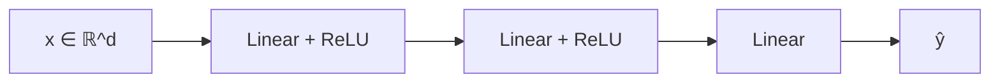

# 01 · MLP (Perceptrón multicapa)

## Qué es
Una pila de capas totalmente conectadas con funciones de activación no lineales. Es el bloque base del deep learning: casi toda arquitectura moderna contiene MLPs dentro (por ejemplo, el *feed-forward network* de cada bloque Transformer).

## Para qué sirve
- Datos **tabulares** (aunque gradient boosting suele ganar con poco dato).
- **Cabezas de clasificación/regresión** sobre embeddings de otros modelos.
- Aproximador universal de funciones: modelos de valor en RL, NeRF, decodificadores.

## Cómo funciona

Cada capa: `h = σ(Wx + b)`. Sin `σ`, la composición de capas colapsa a una sola transformación lineal.

- **Entrenamiento**: forward → pérdida (`CrossEntropy`, `MSE`) → *backpropagation* (regla de la cadena) → optimizador (SGD, Adam/AdamW).
- **Activaciones**: ReLU (default), GELU/SiLU (Transformers), sigmoide/softmax solo en la salida.
- **Inicialización**: He/Kaiming para ReLU, Xavier para tanh. Una mala inicialización causa gradientes que se desvanecen o explotan.

## Variantes
- **Residual MLP / MLP-Mixer**: conexiones residuales o mezcla por tokens/canales.
- **SwiGLU / GeGLU**: FFN con compuertas, usado en LLaMA y PaLM.
- **Con regularización**: Dropout, weight decay, BatchNorm/LayerNorm.

## Pros y contras
| Ventajas | Limitaciones |
|---|---|
| Simple, rápido, fácil de depurar | No explota estructura espacial ni secuencial |
| Buen punto de partida | En tabular, a menudo pierde contra XGBoost/LightGBM |
| Base de todo lo demás | Muchos parámetros si la entrada es grande (imagen cruda) |

## Cuándo usarla
Cuando la entrada es un vector de tamaño fijo sin estructura. Si hay estructura (imagen, secuencia, grafo), usa la arquitectura que la aproveche.

## Ejemplo
[`examples/mlp.py`](../examples/mlp.py)

## Notas de práctica
- Antes de entrenar una red en datos tabulares, prueba XGBoost o LightGBM: casi siempre ganan con pocos datos y se entrenan en minutos.
- Normaliza las entradas y revisa que la pérdida baje en un lote pequeño (overfitting intencional). Si no puede memorizar 32 ejemplos, hay un bug.
- Mide siempre contra una baseline trivial (media, clase mayoritaria, regresión logística).

## Referencias
- Rumelhart, Hinton, Williams (1986). *Learning representations by back-propagating errors*.
- Shwartz-Ziv & Armon (2022). *Tabular Data: Deep Learning is Not All You Need*.
