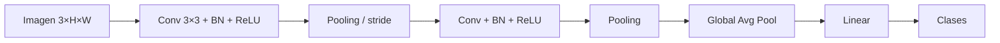

# 02 · CNN (Redes convolucionales)

## Qué es
Red que reemplaza multiplicaciones densas por **convoluciones**: un pequeño filtro que se desliza sobre la entrada compartiendo pesos. Incorpora dos sesgos inductivos: **localidad** (los píxeles cercanos se relacionan) y **equivarianza a traslación** (un gato es un gato en cualquier posición).

## Para qué sirve
- Clasificación, detección y segmentación de **imágenes** (ResNet, YOLO, U-Net).
- **Audio** (espectrogramas), señales 1D (ECG), texto con Conv1D (TCN).
- Extractor de características en visión por computadora industrial y médica.

## Cómo funciona

- **Convolución**: `y[i,j] = Σ_{u,v} W[u,v] · x[i+u, j+v] + b`. Con `K` filtros se obtienen `K` mapas de características.
- **Tamaño de salida**: `out = ⌊(in + 2p − k)/s⌋ + 1`.
- **Campo receptivo**: crece con la profundidad; capas tempranas detectan bordes, las profundas, objetos.
- **Parámetros**: `k·k·C_in·C_out`, independiente del tamaño de la imagen (vs. MLP).

## Variantes clave
| Variante | Aporte |
|---|---|
| **ResNet** | Conexiones residuales `y = F(x) + x` permiten redes de 100+ capas |
| **Depthwise separable** (MobileNet) | Menos cómputo, ideal para móvil/edge |
| **Dilated conv** | Campo receptivo amplio sin perder resolución |
| **U-Net** | Encoder-decoder con skip connections para segmentación |
| **EfficientNet / ConvNeXt** | Escalado compuesto / modernización estilo Transformer |
| **YOLO, Faster R-CNN** | Detección de objetos (una etapa vs. dos) |

## Pros y contras
| Ventajas | Limitaciones |
|---|---|
| Eficiente en parámetros y cómputo | Campo receptivo local; contexto global difícil |
| Excelente con pocos datos de imagen | Menos flexible que ViT al escalar con muchísimo dato |
| Muy optimizada en hardware (cuDNN, TensorRT) | Sesgo de traslación puede estorbar en otras tareas |

## Cuándo usarla
Visión en producción con latencia/costo acotados, edge, o datasets medianos. Con datos masivos y preentrenamiento, considera [ViT](14-multimodal.md) / [Transformer](05-transformer.md).

## Ejemplo
[`examples/cnn.py`](../examples/cnn.py)

## Notas de práctica
- No entrenes desde cero: afina un modelo preentrenado. Con unos cientos de imágenes etiquetadas rinde más que cualquier arquitectura nueva.
- En visión aplicada, el problema suele ser la calidad y consistencia de las etiquetas y la cobertura del dataset, no la arquitectura.
- Valida con datos de las condiciones reales (iluminación, cámara, ángulo). El rendimiento en el set de prueba limpio engaña.

## Referencias
- LeCun et al. (1998). *Gradient-based learning applied to document recognition*.
- He et al. (2015). *Deep Residual Learning for Image Recognition*.
- Ronneberger et al. (2015). *U-Net*.
