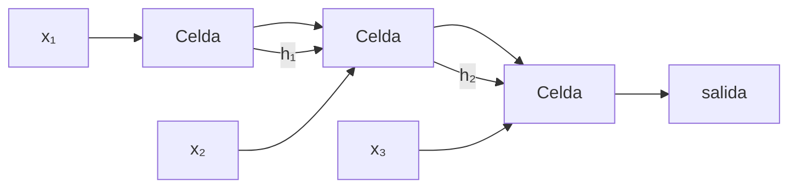

# 03 · RNN, LSTM y GRU

## Qué es
Redes que procesan secuencias paso a paso manteniendo un **estado oculto** `h_t` que resume lo visto hasta ahora. Los mismos pesos se reutilizan en cada paso temporal.

## Para qué sirve
- **Series temporales**: demanda, sensores, finanzas.
- Reconocimiento de voz y modelos de lenguaje *clásicos* (antes de 2017).
- Streaming con memoria constante: inferencia online, un token a la vez.

## Cómo funciona



**RNN simple**: `h_t = tanh(W_x x_t + W_h h_{t-1} + b)`

Se entrena con *backpropagation through time* (BPTT). Problema: el gradiente se multiplica por `W_h` en cada paso → **se desvanece o explota** en secuencias largas.

**LSTM** añade una celda de memoria `c_t` y tres compuertas (olvido `f`, entrada `i`, salida `o`):

```
f_t = σ(W_f [h_{t-1}, x_t])
i_t = σ(W_i [h_{t-1}, x_t])
c_t = f_t ⊙ c_{t-1} + i_t ⊙ tanh(W_c [h_{t-1}, x_t])
o_t = σ(W_o [h_{t-1}, x_t])
h_t = o_t ⊙ tanh(c_t)
```

La ruta aditiva de `c_t` deja fluir el gradiente a largo plazo.

**GRU**: simplificación con dos compuertas (actualización y reinicio), menos parámetros y rendimiento similar.

## Variantes
- **Bidireccional**: lee la secuencia en ambos sentidos (solo si tienes la secuencia completa).
- **Apiladas** (varias capas) y con **dropout recurrente**.
- **TCN** (convoluciones causales dilatadas): alternativa paralelizable.

## Pros y contras
| Ventajas | Limitaciones |
|---|---|
| Memoria constante en inferencia | Entrenamiento **secuencial**: no paraleliza en el tiempo |
| Natural para streaming | Dependencias muy largas siguen siendo difíciles |
| Compactas, buenas en edge | Superadas por Transformers/SSM en NLP |

## Cuándo usarla
Series temporales pequeñas o medianas, dispositivos con poca memoria, o inferencia en streaming. Para secuencias muy largas considera [SSM/Mamba](12-ssm-mamba.md).

## Ejemplo
[`examples/lstm.py`](../examples/lstm.py)

## Notas de práctica
- Antes de un LSTM, calcula una baseline ingenua (el valor anterior, el promedio estacional). Muchas veces el modelo complejo la supera por poco.
- En series temporales, separa train/validación por tiempo, nunca al azar; de lo contrario filtras el futuro al entrenamiento.
- Recorta gradientes (gradient clipping) y empieza con GRU: suele rendir igual con menos parámetros.

## Referencias
- Hochreiter & Schmidhuber (1997). *Long Short-Term Memory*.
- Cho et al. (2014). *Learning Phrase Representations using RNN Encoder-Decoder* (GRU).
