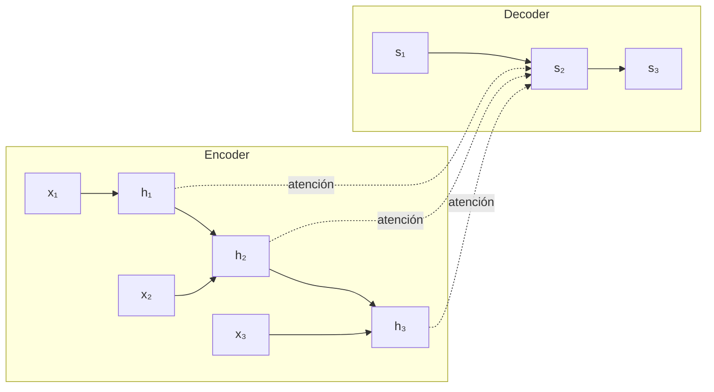

# 04 · Seq2Seq y mecanismo de atención

## Qué es
Arquitectura **encoder-decoder** para transformar una secuencia en otra de longitud distinta. El *encoder* resume la entrada; el *decoder* genera la salida token a token. La **atención** (Bahdanau, 2014) permite al decoder mirar selectivamente cada posición de la entrada en lugar de depender de un único vector de contexto.

## Para qué sirve
Traducción automática, resumen, reconocimiento de voz, generación de subtítulos. Es el puente histórico entre las RNN y el Transformer.

## Cómo funciona



Sin atención el encoder comprime toda la frase en un vector fijo → cuello de botella. Con atención, en cada paso `t` del decoder:

```
score(s_t, h_i) = vᵀ tanh(W_1 s_t + W_2 h_i)      (aditiva)
α_{t,i}         = softmax_i(score)
c_t             = Σ_i α_{t,i} h_i                   (contexto)
```

El contexto `c_t` se concatena con `s_t` para predecir el siguiente token. Los pesos `α` forman una **matriz de alineamiento** interpretable.

## Detalles de entrenamiento y decodificación
- **Teacher forcing**: en entrenamiento el decoder recibe el token real previo, no el predicho.
- **Beam search**: mantiene los `k` mejores candidatos al generar.
- **Exposure bias**: discrepancia entre entrenamiento (token real) e inferencia (token propio).

## Pros y contras
| Ventajas | Limitaciones |
|---|---|
| Maneja longitudes distintas entrada/salida | Secuencial: lento de entrenar |
| Atención mejora mucho frases largas | Reemplazado por Transformers |

## Por qué importa hoy
La idea de atención sobrevive intacta en el [Transformer](05-transformer.md): este eliminó la recurrencia y dejó **solo** atención.

## Notas de práctica
- Hoy se usa como contexto histórico y conceptual; para producción parte de un Transformer preentrenado.
- Visualizar la matriz de atención ayuda a depurar alineamientos, pero no la tomes como una explicación fiel del modelo.

## Referencias
- Sutskever et al. (2014). *Sequence to Sequence Learning with Neural Networks*.
- Bahdanau, Cho, Bengio (2014). *Neural Machine Translation by Jointly Learning to Align and Translate*.
- Luong et al. (2015). *Effective Approaches to Attention-based NMT*.
