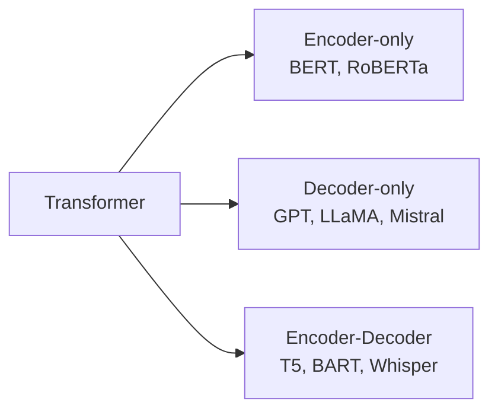
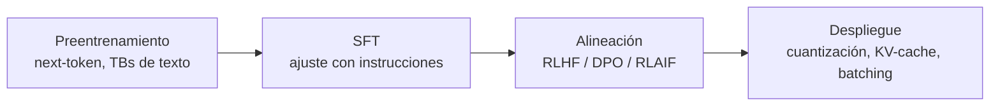

# 06 · Variantes de Transformer: encoder, decoder y encoder-decoder

Del mismo bloque base salen tres familias. La diferencia está en **la máscara de atención** y **el objetivo de preentrenamiento**.

| Familia | Atención | Objetivo de preentrenamiento | Fuerte en | Ejemplos |
|---|---|---|---|---|
| **Encoder-only** | Bidireccional (ve todo) | Masked LM (adivinar tokens ocultos) | Clasificación, NER, embeddings, búsqueda | BERT, RoBERTa, DeBERTa |
| **Decoder-only** | Causal (solo el pasado) | Predecir el siguiente token | Generación, chat, código, razonamiento | GPT, LLaMA, Mistral, Qwen |
| **Encoder-decoder** | Encoder bidireccional + decoder causal con cross-attention | Denoising / span corruption | Traducción, resumen, voz→texto | T5, BART, Whisper |

## Por qué domina decoder-only
- Un solo objetivo simple (next-token) con datos prácticamente ilimitados.
- Escala limpia y *emerge* in-context learning, seguimiento de instrucciones y razonamiento.
- Una arquitectura sirve para generar, clasificar (con prompt) y usar herramientas.

## Pipeline de un LLM de chat

1. **Preentrenamiento**: conocimiento y lenguaje.
2. **SFT**: aprende a seguir instrucciones con ejemplos curados.
3. **Alineación**: preferencias humanas/IA (ver [RL](13-rl.md)); DPO evita entrenar un modelo de recompensa aparte.
4. **Inferencia**: muestreo (temperature, top-p), KV-cache, batching continuo (vLLM), cuantización.

## Cuándo usar cuál
- ¿Necesitas **embeddings o clasificar** barato y rápido? Encoder-only.
- ¿Necesitas **generar texto/código o conversar**? Decoder-only.
- ¿Tarea **entrada→salida bien definida** (traducir, transcribir)? Encoder-decoder.

## Notas de práctica
- Para clasificar o generar embeddings a bajo costo, un encoder pequeño suele bastar y es mucho más barato que un LLM generativo.
- Un LLM generativo con buen prompt es una excelente primera versión; si el volumen crece, destila su comportamiento en un modelo más pequeño.
- Fija temperatura y semilla al evaluar, y compara modelos con el mismo conjunto de pruebas.

## Referencias
- Devlin et al. (2018). *BERT*.
- Radford et al. (2018–2019). *GPT / GPT-2*.
- Raffel et al. (2019). *T5*.
- Rafailov et al. (2023). *Direct Preference Optimization*.
