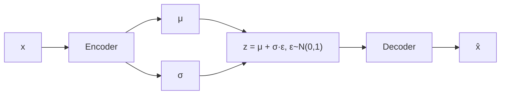

# 07 · Autoencoders y VAE

## Qué es
Un **autoencoder** aprende a comprimir la entrada en un código de baja dimensión (*espacio latente*) y reconstruirla. Un **VAE** (Variational Autoencoder) hace que ese espacio sea probabilístico y continuo, de modo que se pueda **muestrear** para generar datos nuevos.

## Para qué sirve
- **Detección de anomalías**: error de reconstrucción alto = dato raro.
- Reducción de dimensionalidad, denoising, compresión.
- **Generación** y representaciones latentes (el VAE de Stable Diffusion comprime imágenes antes de difundir).

## Cómo funciona



**Autoencoder clásico**: minimiza `‖x − x̂‖²`.

**VAE**: el encoder predice una distribución `q(z|x) = N(μ, σ²)`. Se maximiza la cota inferior de evidencia (ELBO):

```
L = E_q[ log p(x|z) ]  −  KL( q(z|x) ‖ p(z) )
      reconstrucción         regularización hacia N(0, I)
```

**Truco de reparametrización**: `z = μ + σ ⊙ ε` hace el muestreo diferenciable.

## Variantes
- **Denoising AE**, **Sparse AE**, **Contractive AE**.
- **β-VAE**: pondera el KL para desenredar factores latentes.
- **VQ-VAE**: latente discreto (libro de códigos); base de modelos de imagen/audio con tokens (DALL·E 1, Jukebox).
- **SAE (Sparse Autoencoders)**: usados en *interpretabilidad* de LLM para extraer features.

## Pros y contras
| Ventajas | Limitaciones |
|---|---|
| Entrenamiento estable, latente interpretable | Muestras de VAE más borrosas que GAN/difusión |
| Sirve sin etiquetas | Riesgo de *posterior collapse* |
| Útil como componente de otros modelos | |

## Cuándo usarlo
Anomalías sin etiquetas, compresión aprendida, o como tokenizador/compresor previo a otro generativo.

## Ejemplo
[`examples/vae.py`](../examples/vae.py)

## Notas de práctica
- Para anomalías, entrena solo con datos normales y define el umbral de error con un conjunto de validación, no a ojo.
- Si el KL cae a cero y las muestras son idénticas, es posterior collapse: baja el peso del KL o usa un esquema de annealing.

## Referencias
- Kingma & Welling (2013). *Auto-Encoding Variational Bayes*.
- van den Oord et al. (2017). *VQ-VAE*.
