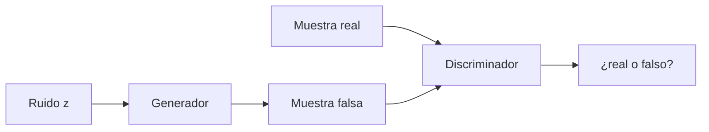

# 08 · GAN (Redes generativas adversarias)

## Qué es
Dos redes que compiten: un **generador** `G` crea muestras falsas a partir de ruido y un **discriminador** `D` intenta distinguir lo real de lo falso. Al mejorar uno, obliga al otro a mejorar.

## Para qué sirve
- Generación de imágenes de alta fidelidad (rostros, arte).
- **Super-resolución**, traducción de imagen (pix2pix, CycleGAN), aumento de datos.
- Generación de voz (HiFi-GAN, vocoders) por su inferencia de un solo paso, muy rápida.

## Cómo funciona



Juego minimax:

```
min_G max_D  E_{x~p_data}[log D(x)] + E_{z~p_z}[log(1 − D(G(z)))]
```

En la práctica, se alternan pasos: actualizar `D` con reales y falsos, luego `G` para engañar a `D` (usando la pérdida no saturante `−log D(G(z))`).

## Problemas típicos
- **Inestabilidad** y no convergencia (oscilaciones).
- **Mode collapse**: el generador produce pocas variedades.
- Métricas difíciles: se usa FID / IS.

## Variantes
| Variante | Idea |
|---|---|
| **DCGAN** | Convoluciones + buenas prácticas de arquitectura |
| **WGAN-GP** | Distancia de Wasserstein + penalización de gradiente → más estable |
| **Conditional GAN** | Condiciona por clase o texto |
| **StyleGAN** | Control por estilo en capas; calidad fotorrealista |
| **CycleGAN** | Traducción entre dominios sin pares |

## Pros y contras
| Ventajas | Limitaciones |
|---|---|
| Muestra en **un solo forward** (rápido) | Entrenamiento frágil |
| Muy buena nitidez | Poca diversidad vs. difusión, sin likelihood explícita |

## Cuándo usarla
Cuando la **latencia de generación** es crítica (tiempo real) o en tareas de traducción de imagen. Para calidad/diversidad y control por texto, hoy se prefiere [difusión](09-difusion.md).

## Ejemplo
[`examples/gan.py`](../examples/gan.py)

## Notas de práctica
- La mayoría de GANs que no convergen sufren desbalance entre generador y discriminador, no un error de arquitectura. Ajusta tasas de aprendizaje y usa WGAN-GP o normalización espectral.
- Salvo que necesites latencia mínima de generación, hoy suele ser más sencillo usar difusión.
- Monitorea FID y revisa muestras a mano: la pérdida del GAN no indica calidad.

## Referencias
- Goodfellow et al. (2014). *Generative Adversarial Nets*.
- Arjovsky et al. (2017). *Wasserstein GAN*.
- Karras et al. (2019). *StyleGAN*.
