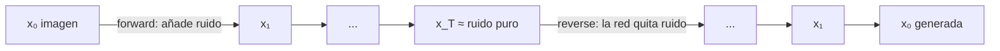
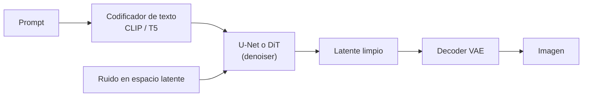

# 09 · Modelos de difusión

## Qué es
Modelos generativos que aprenden a **revertir un proceso de ruido gradual**. Se entrena una red para quitar un poco de ruido; al generar, se parte de ruido puro y se denoisa en muchos pasos hasta obtener una muestra.

## Para qué sirve
Generación de **imagen, video, audio y 3D** con control por texto: Stable Diffusion, DALL·E, Midjourney, Sora, y también edición (inpainting), super-resolución y generación de moléculas.

## Cómo funciona



**Proceso hacia adelante** (fijo): `x_t = √ᾱ_t · x₀ + √(1−ᾱ_t) · ε`, con `ε ~ N(0, I)`. Se puede saltar directo a cualquier `t`.

**Entrenamiento** (simple): sortear `t`, añadir ruido, y que la red `ε_θ` lo prediga:

```
L = E_{x₀, t, ε} ‖ ε − ε_θ(x_t, t, c) ‖²
```

donde `c` es la condición (texto, clase).

**Muestreo**: `T` pasos (DDPM ~1000; DDIM / DPM-Solver / *flow matching* 20–50, o destilados en 1–4).

## Piezas de un sistema tipo Stable Diffusion



- **Difusión latente**: se difunde en el espacio comprimido de un [VAE](07-autoencoders-vae.md), reduciendo el costo muchísimo.
- **Classifier-free guidance**: mezcla predicción condicional e incondicional (`ε_u + w(ε_c − ε_u)`) para más fidelidad al prompt.
- **DiT**: sustituye el U-Net por un [Transformer](05-transformer.md); escala mejor (Sora, SD3, Flux).
- **ControlNet / LoRA / IP-Adapter**: control fino y personalización.

## Pros y contras
| Ventajas | Limitaciones |
|---|---|
| Calidad y diversidad superiores, entrenamiento estable | Muestreo iterativo: lento |
| Condicionamiento flexible | Alto costo de entrenamiento |
| Cobertura de modos | Requiere destilación para tiempo real |

## Cuándo usarla
Generación o edición de contenido visual/auditivo de alta calidad. Para latencia mínima, considera [GAN](08-gan.md) o difusión destilada.

## Ejemplo
[`examples/diffusion_toy.py`](../examples/diffusion_toy.py)

## Notas de práctica
- El costo está en el muestreo: ajusta número de pasos y scheduler antes de pensar en reentrenar.
- Para personalizar un modelo existente, LoRA o ajuste ligero es suficiente en la mayoría de casos; entrenar uno desde cero es muy caro.
- Fija la semilla y registra los parámetros (guidance, pasos, scheduler) para poder reproducir resultados.

## Referencias
- Ho et al. (2020). *Denoising Diffusion Probabilistic Models*.
- Rombach et al. (2022). *Latent Diffusion Models*.
- Peebles & Xie (2023). *Scalable Diffusion Models with Transformers (DiT)*.
- Lipman et al. (2023). *Flow Matching*.
