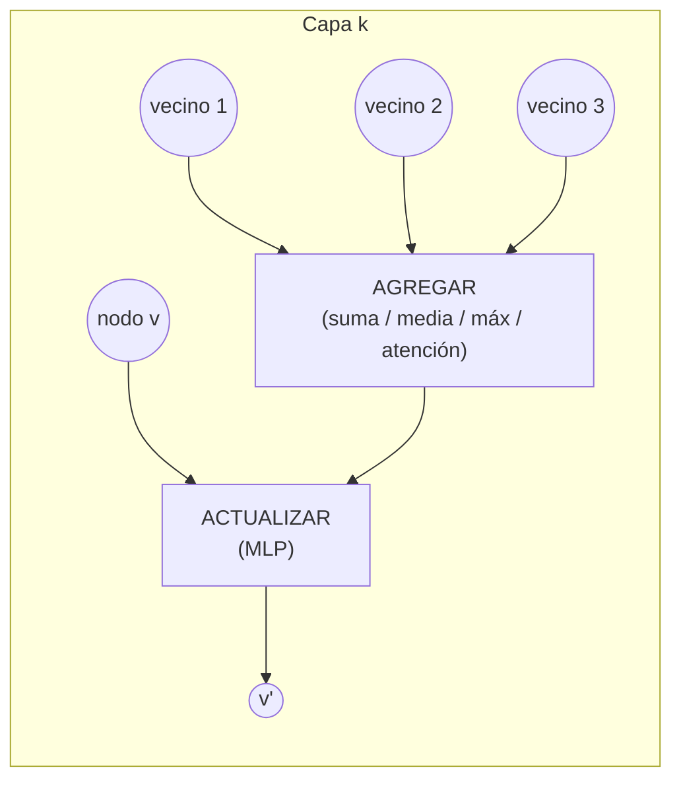

# 10 · GNN (Redes neuronales de grafos)

## Qué es
Redes que operan sobre **grafos** (nodos + aristas) mediante *paso de mensajes*: cada nodo actualiza su representación agregando información de sus vecinos. Respetan la **invarianza a permutaciones** (el orden de los nodos no importa).

## Para qué sirve
- **Química/biología**: predicción de propiedades de moléculas, descubrimiento de fármacos.
- **Redes sociales y recomendación** (Pinterest PinSage), detección de fraude.
- Tráfico y rutas (ETA en mapas), conocimiento (knowledge graphs), simulación física.

## Cómo funciona



```
h_v^(k+1) = UPDATE( h_v^(k),  AGGREGATE({ h_u^(k) : u ∈ N(v) }) )
```

Con `K` capas, cada nodo "ve" a vecinos a distancia `K`. Para predecir a nivel de grafo se aplica un *readout* (pooling global).

## Variantes
| Modelo | Agregación |
|---|---|
| **GCN** | Media normalizada por grado: `D^{-½} A D^{-½} H W` |
| **GraphSAGE** | Muestreo de vecinos → escala a grafos enormes |
| **GAT** | Atención sobre vecinos (pesos aprendidos) |
| **GIN** | Suma + MLP; tan expresiva como el test WL |
| **Graph Transformers** | Atención global con codificaciones posicionales de grafo |
| **E(3)-equivariantes** (SchNet, NequIP) | Respetan rotaciones/traslaciones 3D |

## Problemas conocidos
- **Over-smoothing**: con muchas capas, todos los nodos se parecen.
- **Over-squashing**: información de vecindarios grandes se comprime en un vector.
- Escalabilidad: muestreo (GraphSAGE), clustering (Cluster-GCN).

## Pros y contras
| Ventajas | Limitaciones |
|---|---|
| Aprovecha relaciones explícitas | Capas profundas degradan |
| Inductivo: generaliza a grafos nuevos | Grafos gigantes requieren muestreo |

## Cuándo usarla
Cuando la **estructura relacional** es parte esencial del dato. Si puedes serializarlo y la estructura es débil, un [Transformer](05-transformer.md) puede bastar.

## Ejemplo
[`examples/gnn.py`](../examples/gnn.py) (capa GCN en PyTorch puro)

## Notas de práctica
- Definir bien el grafo (qué es un nodo, qué arista cuenta, qué features lleva) pesa más que la capa de GNN que elijas.
- Empieza con 2 o 3 capas. Más capas suelen causar over-smoothing.
- Compara contra un modelo que ignore la estructura (MLP sobre features de nodo) para confirmar que el grafo aporta valor.

## Referencias
- Kipf & Welling (2016). *Semi-Supervised Classification with GCNs*.
- Hamilton et al. (2017). *GraphSAGE*.
- Veličković et al. (2017). *Graph Attention Networks*.
