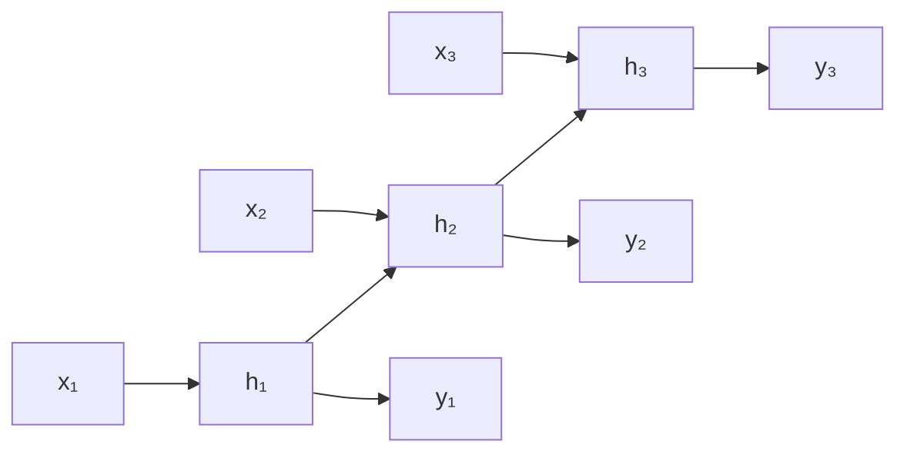

# 12 · State Space Models (S4, Mamba)

## Qué es
Modelos de secuencia inspirados en sistemas dinámicos lineales. Combinan lo mejor de dos mundos: se **entrenan en paralelo** (como un Transformer, vía convolución/scan) y **infieren de forma recurrente** con memoria constante (como una RNN).

## Para qué sirve
Secuencias **muy largas** (audio crudo, genómica, series de alta frecuencia, contextos largos) donde la atención cuadrática se vuelve prohibitiva.

## Cómo funciona
Sistema continuo lineal, luego discretizado:

```
h'(t) = A h(t) + B x(t)          →  h_t = Ā h_{t-1} + B̄ x_t
y(t)  = C h(t)                       y_t = C h_t
```



- **Dos vistas equivalentes** (en modelos invariantes en el tiempo): recurrencia (inferencia O(1) por paso) y convolución larga (entrenamiento paralelo con FFT).
- **S4**: inicialización HiPPO de `A` para recordar historia larga.
- **Mamba (S6)**: hace `B, C, Δ` **dependientes de la entrada** (selectividad): el modelo decide qué recordar u olvidar. Pierde la vista convolucional, así que usa un **scan paralelo** optimizado en GPU.
- **Mamba-2 / SSD**: muestra la dualidad entre SSM y atención.

## Comparativa

| | Transformer | RNN/LSTM | SSM (Mamba) |
|---|---|---|---|
| Entrenamiento | Paralelo | Secuencial | Paralelo |
| Costo vs. longitud | O(n²) | O(n) | O(n) |
| Memoria en inferencia | Crece (KV-cache) | Constante | Constante |
| Recuperar un dato exacto del contexto | Excelente | Débil | Más débil (estado comprimido) |

## Híbridos
Dado que la atención recupera mejor datos exactos, hay modelos **híbridos** que intercalan capas SSM y atención (Jamba, Zamba, Samba).

## Pros y contras
| Ventajas | Limitaciones |
|---|---|
| Escala lineal, memoria constante | Ecosistema/herramientas menos maduro |
| Muy rápido en inferencia de contexto largo | Peor en *copy / recall* exacto que atención |

## Cuándo usarlo
Contextos largos con presupuesto limitado, streaming, o como parte de un híbrido.

## Notas de práctica
- La ventaja aparece en secuencias realmente largas. En contextos cortos, un Transformer bien optimizado suele ser igual de rápido.
- Para tareas que exigen recuperar datos exactos del contexto, considera un híbrido con algunas capas de atención.

## Referencias
- Gu et al. (2021). *Efficiently Modeling Long Sequences with S4*.
- Gu & Dao (2023). *Mamba: Linear-Time Sequence Modeling with Selective State Spaces*.
- Dao & Gu (2024). *Transformers are SSMs* (Mamba-2).
