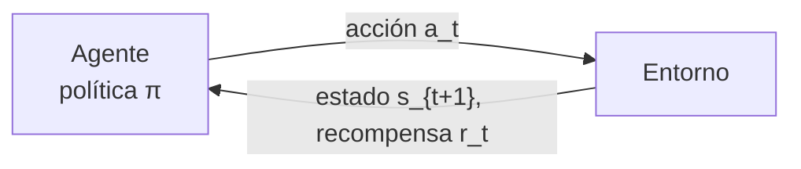

# 13 · Aprendizaje por refuerzo (RL)

## Qué es
Un **agente** interactúa con un **entorno**, observa estados, ejecuta acciones y recibe **recompensas**. Aprende una *política* `π(a|s)` que maximiza la recompensa acumulada. No hay etiquetas: hay prueba, error y señal retardada.

## Para qué sirve
- **Juegos y control**: AlphaGo/AlphaZero, Atari, robótica, drones.
- **Alineación de LLM**: RLHF (PPO), RLVR / GRPO con recompensas verificables (matemáticas, código).
- Optimización de operaciones: enfriamiento de centros de datos, ruteo, trading, asignación de recursos.

## Cómo funciona



Marco: **MDP** `(S, A, P, R, γ)`. Objetivo: `J(π) = E[ Σ γ^t r_t ]`.

### Familias de algoritmos
| Familia | Idea | Algoritmos |
|---|---|---|
| **Basados en valor** | Aprender `Q(s,a)`; actuar con argmax | DQN, Double DQN, Rainbow |
| **Policy gradient** | Optimizar `π` directamente | REINFORCE, A2C, **PPO**, TRPO |
| **Actor-Crítico continuo** | Actor + crítico, acciones continuas | DDPG, TD3, **SAC** |
| **Basados en modelo** | Aprender el entorno y planificar | Dreamer, MuZero |
| **Offline RL** | Aprender de datos fijos | CQL, IQL |

Ecuaciones clave:

```
Bellman:         Q(s,a) = r + γ · max_{a'} Q(s', a')
Policy gradient: ∇J = E[ ∇ log π(a|s) · A(s,a) ]
PPO (recorte):   L = E[ min( r_t(θ) Â_t,  clip(r_t(θ), 1−ε, 1+ε) Â_t ) ]
```

### RLHF en una línea
SFT → entrenar un **modelo de recompensa** con preferencias humanas → optimizar el LLM con PPO (con penalización KL al modelo original). Alternativas: **DPO** (sin RL explícito), **GRPO**.

## Retos
- **Exploración vs. explotación**, recompensas escasas.
- Muy **ineficiente en muestras** y sensible a hiperparámetros.
- *Reward hacking*: el agente explota la métrica en lugar de la intención.
- Brecha sim-to-real en robótica.

## Pros y contras
| Ventajas | Limitaciones |
|---|---|
| Resuelve decisión secuencial sin etiquetas | Inestable y caro en muestras |
| Puede superar a humanos en dominios cerrados | Diseñar la recompensa es difícil |

## Cuándo usarlo
Cuando hay un **entorno simulable o recompensa medible** y las decisiones afectan estados futuros. Si tienes ejemplos supervisados de calidad, empieza con *imitation learning*.

## Ejemplo
[`examples/rl_reinforce.py`](../examples/rl_reinforce.py) (REINFORCE en un bandido/entorno mínimo, sin dependencias externas)

## Notas de práctica
- Si puedes resolver el problema con aprendizaje supervisado o imitación, hazlo. RL es el último recurso: es inestable, costoso en muestras y la recompensa es difícil de diseñar.
- Primero construye un simulador o entorno fiable y una baseline con reglas; si la baseline ya es buena, quizá no necesites RL.
- Revisa el comportamiento del agente, no solo la recompensa: los agentes explotan fallas de la métrica (reward hacking).

## Referencias
- Sutton & Barto. *Reinforcement Learning: An Introduction*.
- Mnih et al. (2015). *Human-level control through deep RL* (DQN).
- Schulman et al. (2017). *Proximal Policy Optimization*.
- Silver et al. (2017). *Mastering the game of Go without human knowledge*.
