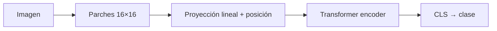
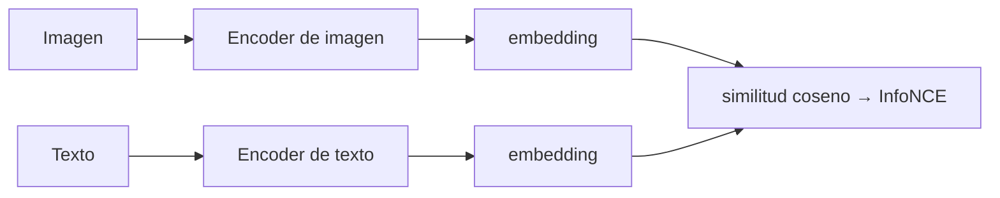
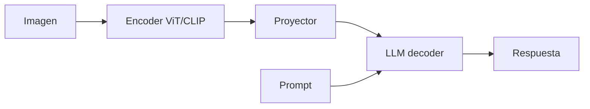

# 14 · Multimodal: ViT, CLIP y modelos visión-lenguaje

## Qué es
Arquitecturas que procesan o conectan **varias modalidades** (imagen, texto, audio, video) en un espacio de representación compartido o en un mismo Transformer.

## Piezas fundamentales

### ViT (Vision Transformer)
Divide la imagen en parches (p. ej. 16×16), los proyecta linealmente a embeddings y los trata como tokens de un [Transformer](05-transformer.md). Con datos suficientes iguala o supera a las [CNN](02-cnn.md).



### CLIP (aprendizaje contrastivo)
Dos encoders (imagen y texto) entrenados para que pares correctos queden **cerca** en el mismo espacio y los incorrectos **lejos**.



```
L = −log  exp(sim(z_i, z_t)/τ) / Σ_j exp(sim(z_i, z_j)/τ)
```

Habilita **búsqueda semántica**, clasificación *zero-shot* y es el codificador de texto/imagen de muchos sistemas de difusión.

### VLM (Vision-Language Models)
Patrón dominante: **encoder de visión → adaptador (proyector/Q-Former) → LLM**.



Ejemplos: LLaVA, Flamingo, PaliGemma, y modelos de frontera nativamente multimodales (tokens de texto, imagen y audio en una sola secuencia).

## Variantes de fusión
| Estrategia | Descripción |
|---|---|
| **Early fusion** | Todo se tokeniza y entra al mismo Transformer |
| **Late fusion** | Cada modalidad se codifica por separado y se combina al final |
| **Cross-attention** | Una modalidad atiende a la otra (Flamingo) |
| **Contrastivo** | Alinear embeddings (CLIP, ImageBind, CLAP) |

## Pros y contras
| Ventajas | Limitaciones |
|---|---|
| Zero-shot y flexibilidad entre modalidades | Datos alineados costosos; sesgos heredados |
| Búsqueda y RAG multimodal | Alucinaciones visuales, resolución limitada |

## Cuándo usarlo
Búsqueda por imagen/texto, OCR y comprensión de documentos, asistentes que "ven", moderación de contenido.

## Notas de práctica
- Para búsqueda por imagen o texto, embeddings tipo CLIP más un índice vectorial resuelven mucho con poco esfuerzo.
- Los VLM fallan con texto pequeño, resolución baja y conteo. Evalúa con tus propias imágenes antes de comprometerte.

## Referencias
- Dosovitskiy et al. (2020). *An Image is Worth 16x16 Words (ViT)*.
- Radford et al. (2021). *CLIP*.
- Alayrac et al. (2022). *Flamingo*.
- Liu et al. (2023). *Visual Instruction Tuning (LLaVA)*.
