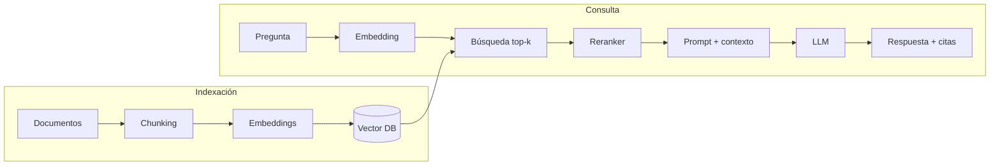
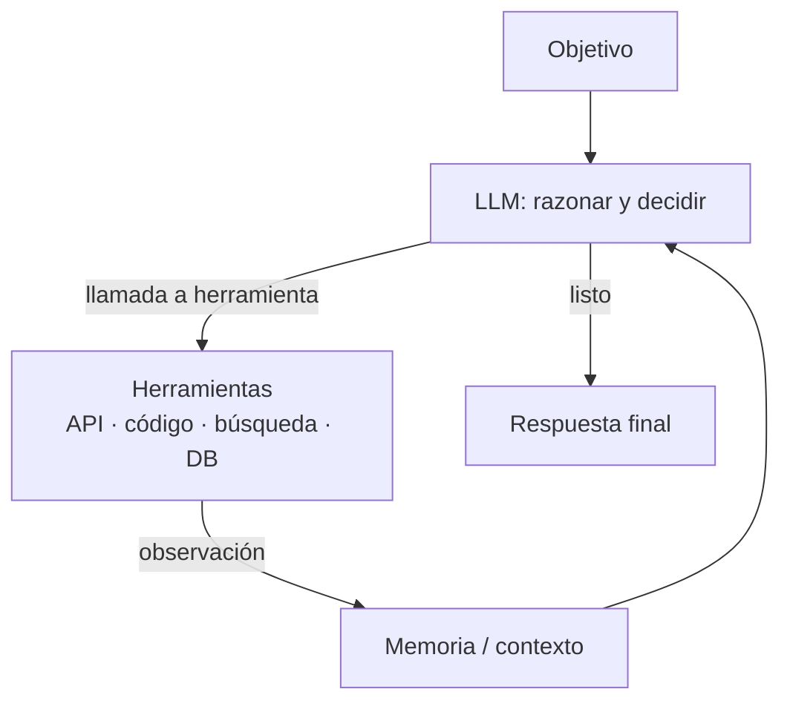

# 15 · RAG y Agentes (arquitecturas de sistema)

> Estas **no son redes neuronales nuevas**: son patrones de *sistema* que rodean a un LLM. Hoy son la forma más común de llevar IA a producción.

## RAG (Retrieval-Augmented Generation)

### Qué es
En lugar de confiar solo en lo que el modelo memorizó, **se recupera información relevante** de una base de conocimiento y se inyecta en el prompt.

### Para qué sirve
Preguntas sobre datos propios/privados o cambiantes, reducir alucinaciones, citar fuentes, sin reentrenar el modelo.

### Pipeline

Decisiones técnicas que importan:
- **Chunking**: tamaño, solapamiento, respetar estructura (títulos, tablas).
- **Embeddings**: modelo adecuado al idioma/dominio.
- **Búsqueda híbrida**: densa (vectorial) + léxica (BM25) combinadas (RRF).
- **Reranking**: un cross-encoder reordena los top-k para precisión.
- **Evaluación**: *recall@k* del retriever y *fidelidad* (groundedness) de la respuesta por separado.
- Variantes: **GraphRAG**, query rewriting, HyDE, RAG multimodal.

### RAG vs. fine-tuning
| | RAG | Fine-tuning |
|---|---|---|
| Conocimiento nuevo / actualizable | Sí | No (reentrenar) |
| Estilo, formato, tarea específica | Parcial | Sí |
| Citas y trazabilidad | Ventajas | Limitaciones |
| Costo operativo | Infra de búsqueda | Entrenamiento |

---

## Agentes

### Qué es
Un LLM en **bucle** que razona, **llama herramientas** (APIs, código, búsqueda, bases de datos) y observa los resultados hasta cumplir un objetivo.

### Componentes
- **Planificación**: ReAct (razonar + actuar), plan-and-execute, árboles de búsqueda.
- **Herramientas**: *function calling* con esquemas JSON; estándar abierto **MCP** (Model Context Protocol).
- **Memoria**: corto plazo (contexto), largo plazo (vector store, archivos).
- **Multi-agente**: orquestador + sub-agentes especializados o en paralelo.
- **Guardarraíles**: permisos mínimos, confirmación humana en acciones irreversibles, límites de pasos/costo, sandbox para ejecutar código.

### Riesgos
- **Inyección de prompts** (instrucciones maliciosas en datos recuperados).
- Errores acumulativos en tareas largas, costos y latencia impredecibles.
- Necesidad de **evals** y trazabilidad (logs de cada paso).

## Cuándo usar cada uno
- ¿Responder con tus documentos? → **RAG**.
- ¿Ejecutar acciones o tareas multi-paso? → **Agente** (que puede usar RAG como herramienta).
- Empieza por el sistema más simple (un prompt, luego RAG, luego flujo fijo) y añade autonomía solo si hace falta.

## Notas de práctica
- La mayoría de los problemas de un RAG son de recuperación, no del LLM. Revisa chunking, embeddings y recall@k antes de tocar el prompt.
- Evalúa recuperación y generación por separado; si no sabes cuál falla, no sabes qué arreglar.
- En agentes, empieza con un flujo fijo de pasos. Cada decisión que delegas al modelo multiplica los errores posibles.
- Pon límites de pasos y de costo, permisos mínimos y confirmación humana en cualquier acción irreversible.
- Registra cada paso y herramienta usada (trazas). Sin eso depurar un agente es casi imposible.

## Referencias
- Lewis et al. (2020). *Retrieval-Augmented Generation for Knowledge-Intensive NLP Tasks*.
- Yao et al. (2022). *ReAct: Synergizing Reasoning and Acting in LMs*.
